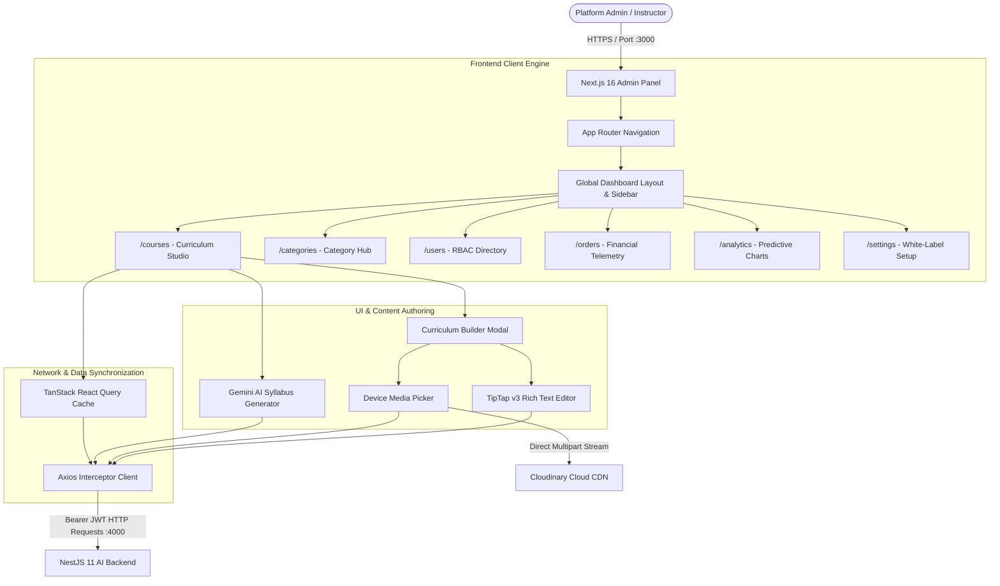

# 🎓 LMS Admin Panel — Enterprise Curriculum & Operations Suite

[](https://nextjs.org/)
[](https://react.dev/)
[](https://www.typescriptlang.org/)
[](https://tailwindcss.com/)
[](https://tiptap.dev/)
[](https://tanstack.com/query)
[](https://cloudinary.com/)
[](https://ai.google.dev/)

An enterprise-grade, high-performance administrative command center and curriculum authoring suite for modern **Learning Management Systems (LMS)**. Built with **Next.js 16 (App Router & Turbopack)**, **React 19**, **Tailwind CSS v4**, and **TypeScript**, this portal provides institutional instructors and platform administrators with complete control over course production, AI-powered syllabus generation, rich-text lesson authoring, Cloudinary media ingestion, RBAC access governance, order telemetry, and real-time revenue analytics.

---

## 📑 Table of Contents

- [Core Architectural Highlights](#-core-architectural-highlights)
- [Interactive Feature Matrix](#-interactive-feature-matrix)
  - [1. Course & Curriculum Studio](#1-course--curriculum-studio)
  - [2. TipTap Rich Text & Multimedia Lesson Authoring](#2-tiptap-rich-text--multimedia-lesson-authoring)
  - [3. AI Neural Syllabus Generator (Gemini 3.8 Flash)](#3-ai-neural-syllabus-generator-gemini-38-flash)
  - [4. Cloudinary Cloud Media Pipeline](#4-cloudinary-cloud-media-pipeline)
  - [5. Category Management Hub](#5-category-management-hub)
  - [6. User Management & Role-Based Access Control (RBAC)](#6-user-management--role-based-access-control-rbac)
  - [7. Orders & Financial Telemetry](#7-orders--financial-telemetry)
  - [8. Real-time Predictive Analytics](#8-real-time-predictive-analytics)
- [Design System & UI Tokens](#-design-system--ui-tokens)
- [System Architecture](#-system-architecture)
- [Technology Stack](#-technology-stack)
- [Project Directory Structure](#-project-directory-structure)
- [Environment Configuration](#-environment-configuration)
- [Getting Started](#-getting-started)
  - [Prerequisites](#prerequisites)
  - [Installation](#installation)
  - [Running the Development Server](#running-the-development-server)
  - [Running Vitest Unit Tests](#running-vitest-unit-tests)
  - [Building for Production](#building-for-production)
- [API Integration & Axios Interceptors](#-api-integration--axios-interceptors)
- [Available NPM Scripts](#-available-npm-scripts)
- [Deployment Guidelines](#-deployment-guidelines)
- [Contributing & License](#-contributing--license)

---

## 🌟 Core Architectural Highlights

- **Pure Canvas Aesthetics**: Crafted with strict adherence to institutional minimalism—pure `#FFFFFF` canvas, `#EDEDED` structural borders, and authoritative `#1C4D8D` Brand Primary with no jarring contrasts or mock data flickers.
- **Next.js 16 & React 19 Engine**: Built using Next.js App Router with React Server Components (RSC) and client-side hydration, optimized with Turbopack for ultra-fast HMR (<150ms reload times).
- **Zero Mock-Data Flicker**: Real-time hydration with zero default mock fallbacks. Pages initiate with clean empty states (`[]`) and render tailored skeleton loaders (`CoursesSkeleton`) until live database REST responses resolve.
- **TipTap v3 Rich Text Processing**: Integrated WYSIWYG text engine generating semantic HTML for comprehensive lesson notes, syntax blocks, bullet lists, and anchor references.
- **Device-to-Cloud Pipeline**: Native multi-format media uploader (`upload-thumbnail` and `upload-media`) communicating with Cloudinary CDN for instant image previews, video streaming, and PDF resources.
- **AI Neural Generator**: Google Gemini 3.8 Flash copilot that takes coarse course descriptions and compiles modular chapter breakdowns and lesson titles in seconds.
- **Resilient Security Handshake**: Axios HTTP interceptors automatically attach JWT Bearer tokens to outbound requests and gracefully wipe sessions on 401 Unauthorized responses.

---

## 🚀 Interactive Feature Matrix

### 1. Course & Curriculum Studio
- **Course Lifecycle Management**: Create, edit, inspect, and delete courses with full metadata (title, slug, category, level, pricing, discount, tags, requirements, and Cloudinary thumbnail).
- **Multi-Module Curriculum Builder**:
  - Dynamically create, rename, re-order, and delete curriculum modules.
  - Module lock indicators for drip-content delivery and prerequisite tracks.
  - Real-time lesson count and total module duration rollup.
- **Course Status Auditing**: Real-time publication status indicators (`PUBLISHED`, `DRAFT`, `ARCHIVED`) with dual Grid and Table views.

### 2. TipTap Rich Text & Multimedia Lesson Authoring
- **Professional WYSIWYG Engine**: Integrated with `@tiptap/react`, `@tiptap/starter-kit`, `@tiptap/extension-link`, `@tiptap/extension-underline`, and `@tiptap/extension-placeholder`.
- **Formatting Toolbar**:
  - Headings (H1, H2, H3), Bold, Italic, Underline, Strikethrough, Code blocks, and Blockquotes.
  - Bullet and ordered lists with keyboard shortcuts.
  - Inline hyperlink insertion and removal.
  - Undo / Redo history stack.
- **Lesson Resource Attachments**:
  - Direct video uploads (`.mp4`, `.webm`, `.mkv`) to Cloudinary or external streaming links (YouTube, Vimeo).
  - Downloadable asset attachments (PDFs, exercise files, ZIP archives).
  - Free preview toggle allowing un-enrolled students to sample introductory lessons.
  - Precise duration in minutes with automated course-wide duration summation.

### 3. AI Neural Syllabus Generator (Gemini 3.8 Flash)
- **Automated Curriculum Synthesis**: Instructors input a course topic, target audience, and proficiency level (`BEGINNER`, `INTERMEDIATE`, `ADVANCED`).
- **Prompt Engineering**: Backend sends structured prompts to Gemini 3.8 Flash (with Groq fallback) returning a complete JSON roadmap.
- **One-Click Module Injection**: The admin panel renders the proposed syllabus in an interactive preview and allows instructors to inspect, modify, or inject all modules and lessons directly into the course curriculum with a single click.

### 4. Cloudinary Cloud Media Pipeline
- **Device File Selection**: Eliminates manual URL typing. Users select images, videos, and PDFs directly from their local device.
- **Instant Client-Side Feedback**: Selected images render instant local blob previews while background uploads execute.
- **Auto Resource Detection**: Uploads route through `@Post('courses/upload-media')` on the NestJS backend, which streams to Cloudinary with automated MIME detection (`image`, `video`, or `raw` for PDFs/docs).

### 5. Category Management Hub
- **Dedicated Page (`/categories`)**: Clean catalog view separate from course creation workflows.
- **Dual Display Modes**: Seamlessly toggle between a responsive Card Grid view and a high-density tabular view.
- **Real-Time Course Counter**: Automatically aggregates and displays the exact count of enrolled courses associated with each category.
- **Quick Modal Additions**: In-modal creation from the course editor enables instructors to create new categories on the fly without losing their draft state.

### 6. User Management & Role-Based Access Control (RBAC)
- **Directory Telemetry**: Monitor all registered users across the platform with avatar fallbacks, email, phone, and registration timestamps.
- **Role Governance**: Filter users by authorization role (`ADMIN`, `TEACHER`, `STUDENT`) and modify role privileges.
- **Security Moderation**: Instant one-click toggle to transition accounts between `ACTIVE` and `BLOCKED` states.

### 7. Orders & Financial Telemetry
- **Transaction Audit Log**: Monitor student checkout events, customer identifiers, payment methods, transaction reference codes, and timestamps.
- **SSLCommerz Telemetry**: Track real-time gateway status (`COMPLETED`, `PENDING`, `FAILED`, `CANCELLED`).
- **Financial Metric Cards**: Real-time KPI summaries for total revenue collected, success rates, pending gateway callbacks, and dispute ratios.

### 8. Real-time Predictive Analytics
- **Financial Charts**: Revenue velocity curves rendered using **Recharts** area charts with custom tooltips.
- **Student Engagement Metrics**: Active student retention, weekly course completion rates, and enrollment distribution breakdowns.
- **Overview KPI Cards**: Total students, active instructors, published courses, and total verified certificates issued.

---

## 🎨 Design System & UI Tokens

The admin panel adheres to an uncompromising, enterprise-grade design token system configured in `src/app/globals.css`:

```css
/* Core Color Tokens */
--color-primary: #1C4D8D;         /* Institutional Brand Primary */
--color-primary-hover: #153A6B;   /* Deep Navy Interactive Hover */
--color-canvas: #FFFFFF;          /* Pure White Background */
--color-border: #EDEDED;          /* Subtle Component Border */
--color-subtext: #64748B;         /* Slate Secondary Typography */
--color-heading: #0F172A;         /* Slate Dark Typography */
```

### Standardized Form Elements
- **Input & Select Height**: Strictly locked to `h-[40px]` across all modals, drawers, and forms for absolute geometric rhythm.
- **Border Treatments**: `border border-[#EDEDED] focus:border-[#1C4D8D] focus:ring-1 focus:ring-[#1C4D8D]` with smooth 150ms transitions.
- **Label Standards**: Standardized with `body-sm-medium` typography, subtle required asterisks (`text-rose-500`), and descriptive subtext.

### Reusable Atomic Components
| Component | Path | Description |
|---|---|---|
| `PrimaryButton` | `@/components/ui/primary-button` | Solid `#1C4D8D` interactive button with hover states and loading spinners |
| `SecondaryButton` | `@/components/ui/secondary-button` | Bordered `#EDEDED` button with icon support and subtle hover transitions |
| `PageHeader` | `@/components/ui/PageHeader` | Standardized page title, description, badge tag, and right-aligned actions |
| `Datatable` | `@/components/ui/Datatable` | Generic, type-safe data table with custom cells, sorting, and pagination |
| `ToneBadge` | `@/components/ui/ToneBadge` | Status badges (`primary`, `navy`, `green`, `rose`, `amber`, `ice`) |
| `RichTextEditor`| `@/components/ui/RichTextEditor` | TipTap v3 WYSIWYG editor with complete formatting toolbar |
| `Modal` | `@/components/ui/Modal` | Accessible backdrop modal with header, body, and action footer |
| `StatGroupCard` | `@/components/ui/StatGroupCard` | Financial & operational KPI statistic card grid |
| `Avatar` | `@/components/ui/Avatar` | User profile avatar with image source and initials fallback |

---

## 🏗️ System Architecture



---

## 💻 Technology Stack

| Domain | Technologies |
|---|---|
| **Framework** | [Next.js](https://nextjs.org/) `16.4.2` (Turbopack, App Router, React Server Components) |
| **UI Library** | [React](https://react.dev/) `19.3.0` & React DOM `19.3.0` |
| **Language** | [TypeScript](https://www.typescriptlang.org/) `5.x` (Strict mode) |
| **Styling** | [Tailwind CSS](https://tailwindcss.com/) `v4.x` with `@tailwindcss/turbopack` |
| **Rich Text Editor** | [TipTap](https://tiptap.dev/) `v3` (`@tiptap/react`, `@tiptap/starter-kit`, `@tiptap/extension-link`, `@tiptap/extension-underline`, `@tiptap/extension-placeholder`) |
| **Data Fetching & State** | [TanStack React Query](https://tanstack.com/query) `v5`, [Redux Toolkit](https://redux-toolkit.js.org/) `v2`, [Axios](https://axios-http.com/) `v1.20` |
| **Forms & Validation** | [React Hook Form](https://react-hook-form.com/) `v7`, [Zod](https://zod.dev/) `v4`, `@hookform/resolvers` |
| **Visual Charts** | [Recharts](https://recharts.org/) `v3.10` |
| **Animations** | [Framer Motion](https://www.framer.com/motion/) `v14` |
| **Icons & Indicators** | [Lucide React](https://lucide.dev/) `v1.59` |
| **Notifications** | [Sonner](https://sonner.emilkowal.ski/) `v2` (Toast notifications) |
| **Testing Suite** | [Vitest](https://vitest.dev/) `v5`, `@testing-library/react` `v16`, `jsdom` `v29` |

---

## 📁 Project Directory Structure

```text
lms-admin-panel/
├── src/
│   ├── app/                               # Next.js App Router root
│   │   ├── analytics/                     # Platform telemetry & charts page
│   │   ├── categories/                    # Dedicated category hub (Grid & Table views)
│   │   ├── courses/                       # Course catalog & curriculum studio
│   │   ├── login/                         # Administrator authentication page
│   │   ├── orders/                        # SSLCommerz transactions & invoice receipts
│   │   ├── settings/                      # Platform & white-label branding page
│   │   ├── users/                         # RBAC user directory & status moderation
│   │   ├── globals.css                    # Design tokens, typography & CSS variables
│   │   ├── layout.tsx                     # Root HTML shell & Font providers
│   │   └── page.tsx                       # Dashboard executive overview page
│   ├── components/                        # Reusable modular components
│   │   ├── analytics/                     # Recharts engagement graphs
│   │   ├── auth/                          # Login form & authentication wrappers
│   │   ├── categories/                    # Category cards, tables, modal forms & stats
│   │   ├── courses/                       # Course grid, table, filters, modals & builder
│   │   │   ├── curriculum/                # Module cards, lesson modals, TipTap editor
│   │   │   │   ├── CurriculumAiSynthesizer.tsx
│   │   │   │   ├── CurriculumLessonModal.tsx
│   │   │   │   ├── CurriculumLessonRow.tsx
│   │   │   │   ├── CurriculumModuleCard.tsx
│   │   │   │   └── CurriculumModuleModal.tsx
│   │   │   ├── AiSyllabusModal.tsx        # Gemini AI syllabus modal
│   │   │   ├── CourseBannerPicker.tsx     # Device image picker with Cloudinary upload
│   │   │   ├── CreateCourseModal.tsx      # Comprehensive course creation modal
│   │   │   ├── CurriculumBuilderModal.tsx # Full curriculum manager
│   │   │   └── QuickCategoryAdd.tsx       # In-modal category creation
│   │   ├── dashboard/                     # Executive stat cards & recent orders table
│   │   ├── layout/                        # Sidebar navigation, Topbar & Breadcrumbs
│   │   ├── settings/                      # White-label branding form
│   │   ├── ui/                            # Atomic design system components
│   │   │   ├── Datatable.tsx              # Generic type-safe datatable
│   │   │   ├── Modal.tsx                  # Accessible backdrop modal
│   │   │   ├── PageHeader.tsx             # Standard page banner
│   │   │   ├── RichTextEditor.tsx         # TipTap v3 WYSIWYG text editor
│   │   │   ├── ToneBadge.tsx              # Unified status tone badges
│   │   │   ├── primary-button.tsx         # Primary action button
│   │   │   └── secondary-button.tsx       # Secondary outlined button
│   │   └── users/                         # User tables, role edit modal & filters
│   ├── lib/                               # Utility libraries & network clients
│   │   ├── api.ts                         # Axios client with JWT interceptors & REST APIs
│   │   ├── cn.ts                          # clsx and tailwind-merge helper
│   │   └── types.ts                       # Shared TypeScript interfaces & DTOs
│   ├── providers/                         # Context providers (QueryClientProvider, Sonner)
│   ├── store/                             # Redux Toolkit store & slices
│   ├── validations/                       # Zod validation schemas
│   └── __tests__/                         # Vitest unit test suites
├── public/                                # Static brand assets & SVGs
├── package.json                           # Dependencies & project scripts
├── tsconfig.json                          # TypeScript compiler configuration
├── vitest.config.ts                       # Vitest test runner configuration
└── .env.example                           # Client environment variables blueprint
```

---

## ⚙️ Environment Configuration

Create a `.env.local` file in the root of `lms-admin-panel` by copying `.env.example`:

```bash
cp .env.example .env.local
```

Configure your environment variables:

```env
# Backend API Base URL (NestJS server)
NEXT_PUBLIC_API_URL=http://localhost:4000

# Optional: Custom Brand Identification
NEXT_PUBLIC_APP_NAME="LMS Admin Studio"
NEXT_PUBLIC_APP_VERSION="1.0.0"
```

> [!NOTE]
> The Axios network client in `src/lib/api.ts` automatically strips any trailing `/api` suffixes to align cleanly with NestJS route decorators.

---

## 🚀 Getting Started

### Prerequisites
- **Node.js**: `v20.x` or `v22.x` (LTS recommended)
- **npm**: `v10.x` or higher
- **Backend Service**: Running instance of `lms-ai-backend` on port `4000`

### Installation

1. **Clone the repository:**
   ```bash
   git clone https://github.com/imamhossenbu/lms-admin-panel.git
   cd lms-admin-panel
   ```

2. **Install project dependencies:**
   ```bash
   npm install
   ```

3. **Configure Environment Variables:**
   ```bash
   cp .env.example .env.local
   # Ensure NEXT_PUBLIC_API_URL points to your backend instance
   ```

### Running the Development Server

Start Next.js in Turbopack development mode:

```bash
npm run dev
```

Open **[http://localhost:3000](http://localhost:3000)** in your browser.

### Running Vitest Unit Tests

Execute unit tests and component assertions:

```bash
npm run test
```

### Building for Production

Compile an optimized production bundle:

```bash
npm run build
npm run start
```

---

## 📡 API Integration & Axios Interceptors

All outbound network requests are dispatched via the centralized Axios instance in [`src/lib/api.ts`](file:///src/lib/api.ts):

### Request Interceptor
Automatically extracts `admin_token` from `localStorage` and injects it into the HTTP header:
```typescript
apiClient.interceptors.request.use((config) => {
  if (typeof window !== "undefined") {
    const token = localStorage.getItem("admin_token");
    if (token) {
      config.headers.Authorization = `Bearer ${token}`;
    }
  }
  return config;
});
```

### Response Interceptor (Automated 401 Session Purge)
If the backend returns a `401 Unauthorized` on any protected route, the interceptor wipes the expired token and redirects to the login screen:
```typescript
apiClient.interceptors.response.use(
  (response) => response,
  (error) => {
    if (
      typeof window !== "undefined" &&
      error.response?.status === 401 &&
      !error.config?.url?.includes("/auth/login")
    ) {
      localStorage.removeItem("admin_token");
      localStorage.removeItem("admin_user");
    }
    return Promise.reject(error);
  }
);
```

### Core API Client Functions
| Module | API Method | Endpoint | Description |
|---|---|---|---|
| **Auth** | `authApi.login(payload)` | `POST /auth/login` | Authenticate administrator credentials |
| **Auth** | `authApi.getProfile()` | `GET /user/me` | Fetch active user credentials & role |
| **Analytics** | `analyticsApi.getAdminOverview()`| `GET /analytics/admin` | Fetch system-wide revenue & KPIs |
| **Orders** | `ordersApi.getAll()` | `GET /orders/all` | Fetch all student checkout transactions |
| **Courses** | `coursesApi.getAll(params)` | `GET /courses` | Paginated and filtered course catalog |
| **Courses** | `coursesApi.create(data)` | `POST /courses` | Create new course entity |
| **Courses** | `coursesApi.update(id, data)` | `PATCH /courses/:id` | Update course details and metadata |
| **Courses** | `coursesApi.delete(id)` | `DELETE /courses/:id` | Remove course entity |
| **Upload** | `coursesApi.uploadThumbnail(file)`| `POST /courses/upload-thumbnail` | Upload image to Cloudinary CDN |
| **Upload** | `coursesApi.uploadMedia(file)` | `POST /courses/upload-media` | Upload video/PDF to Cloudinary CDN |
| **Curriculum**| `coursesApi.createModule(...)` | `POST /courses/:id/modules` | Add new chapter module to course |
| **Curriculum**| `coursesApi.createLesson(...)` | `POST /courses/:id/modules/:mId/lessons`| Add rich-text lesson with video & resources |
| **Categories**| `categoriesApi.getAll()` | `GET /categories` | Fetch all course disciplines |
| **Categories**| `categoriesApi.create(data)` | `POST /categories` | Register new course category |
| **AI Copilot**| `aiApi.generateCourseOutline(...)`| `POST /ai/generate-course-outline` | Synthesize syllabus via Gemini 3.8 Flash |

---

## 🛠️ Available NPM Scripts

| Script | Command | Purpose |
|---|---|---|
| `npm run dev` | `next dev` | Start development server with Turbopack fast-refresh |
| `npm run build` | `next build` | Compile optimized production application bundle |
| `npm run start` | `next start` | Launch production server on port 3000 |
| `npm run lint` | `eslint` | Run ESLint checks across TypeScript and TSX files |
| `npm run test` | `vitest run` | Execute unit and integration tests via Vitest |

---

## 🌐 Deployment Guidelines

### Deploying to Vercel (Recommended)
1. Push the code to a GitHub repository.
2. Import the project into **[Vercel](https://vercel.com/)**.
3. Select the **Next.js** framework preset.
4. Set Environment Variables:
   - `NEXT_PUBLIC_API_URL`: Your live backend URL (e.g. `https://api.yourdomain.com`).
5. Deploy! Vercel will automatically trigger builds on every git push.

### Docker Production Deployment
A production `Dockerfile` can be used for containerized hosting:
```dockerfile
FROM node:20-alpine AS builder
WORKDIR /app
COPY package*.json ./
RUN npm ci
COPY . .
RUN npm run build

FROM node:20-alpine AS runner
WORKDIR /app
ENV NODE_ENV=production
COPY --from=builder /app/public ./public
COPY --from=builder /app/.next/standalone ./
COPY --from=builder /app/.next/static ./.next/static
EXPOSE 3000
CMD ["node", "server.js"]
```

---

## 🤝 Contributing & License

Contributions, feedback, and pull requests are warmly encouraged!

1. Fork the Project
2. Create your Feature Branch (`git checkout -b feature/NewFeature`)
3. Commit your Changes (`git commit -m 'feat: Add NewFeature'`)
4. Push to the Branch (`git push origin feature/NewFeature`)
5. Open a Pull Request

Distributed under the **MIT License**.
